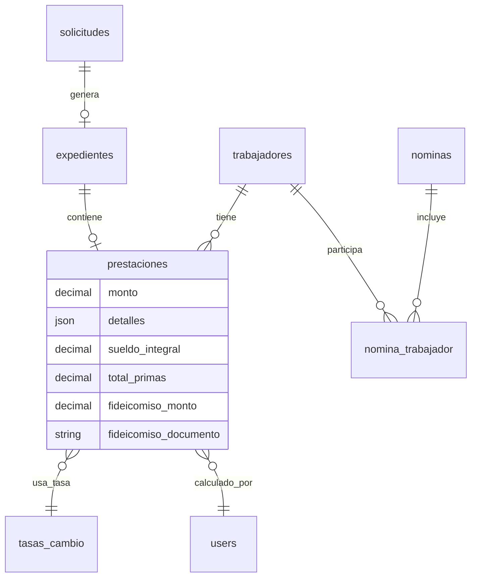

# SIGEJUB — Inventario completo del módulo PRESTACIONES (de la vista hasta la base de datos)

> **Propósito de este documento:** servir como insumo para que otra IA (ChatGPT) construya un
> **diagrama de flujo / diagrama de capas / diagrama ER** del módulo de Prestaciones.
> Aquí se lista **cada componente, su carpeta, su archivo y su rol**, más el flujo paso a paso
> y las tablas de base de datos involucradas.

> **Nota sobre las copias del proyecto:** el repositorio contiene varias copias idénticas del sistema:
> `original/` (fuente canónica), `SIGEJUB-Portable/`, `linux/mysql/`, `linux/postgresql/`,
> `windows/mysql/`, `windows/postgresql/`. **Las rutas de este documento están relativas a `original/`.**
> Las demás copias contienen los mismos archivos con las mismas rutas relativas.

> **Stack:** PHP / Laravel 11 + Eloquent (ORM) + Blade (plantillas) + JavaScript vanilla (fetch) +
> CSS plano + MySQL (por defecto, `.env`: `DB_CONNECTION=mysql`, `DB_DATABASE=bd-sigejub`;
> variantes PostgreSQL en las copias `linux/postgresql` y `windows/postgresql`) +
> DomPDF (`barryvdh/laravel-dompdf ^3.1` en `composer.json`).

---

## 1. Cadena general del flujo (resumen en una línea)

```
Menú del dashboard (index.blade.php)
  → vista sección (secciones/prestaciones.blade.php: HTML + <style> + <script>)
    → JS inline llama a fetch()/cachedFetch() a los endpoints /prestaciones*
      → routes/web.php (middleware auth)
        → PrestacionesController (index / show / store / comprobante / subirDocumentoFideicomiso)
          → Services (ValidationService, NotificationService, ArchivoDbService, DashboardCache)
            → Models Eloquent (Prestacion, Trabajador, Expediente, Solicitud, Nomina, Prima, TasaCambio, Activity, User)
              → Tablas MySQL (prestaciones, trabajadores, expedientes, solicitudes, nominas,
                 nomina_trabajador, primas, tasas_cambio, users, activities, notifications, archivos_bd)
```

---

## 2. CAPA 1 — VISTAS (Blade / HTML)

| Carpeta | Archivo | Rol en el módulo |
|---|---|---|
| `resources/views/dashboard/` | `index.blade.php` | Shell del dashboard. Línea 284: ítem de menú `<li class="menu-item" data-target="prestaciones">`. Línea 325-326: contenedor `<div id="prestaciones" class="content-section">` + `@include('dashboard.secciones.prestaciones')`. Línea 19-193: `<script>` inline que define `window.cachedFetch`, `escaparHTML`, `mostrarToast`. Líneas 441-559: JS de navegación entre secciones (`SECCIONES_DETALLE`, `LISTAS`, muestra/oculta secciones, temporizador de inactividad). Líneas 12-13: carga los CSS. Líneas 369-373: carga los JS. |
| `resources/views/dashboard/secciones/` | **`prestaciones.blade.php`** | **Vista principal del módulo (1020 líneas).** Contiene en un solo archivo: (a) `<style>` inline líneas 2-118 con los estilos propios de la sección (`.prestaciones-grid-cards`, `.prestacion-card`, `.prestacion-detalle-layout`, etc.); (b) HTML líneas 119-277: lista de tarjetas por carpeta (A-Z), vista de detalle con cálculo (sueldo base, primas, totales, fideicomiso, tasa de cambio) y modal "Año de la Prestación"; (c) `<script>` inline líneas 278-1020 con toda la lógica de cliente: `cargarPrestaciones()` (línea 571, llama `cachedFetch('/prestaciones...')`), `abrirDetalle`/fetch a `/prestaciones/{id}` (línea 601), `renderPrimas()`, `guardarPrestacion()` (línea 928, POST `/prestaciones`), `generarComprobante()` (línea 961, POST `/prestaciones/{id}/comprobante`), subida de documento de fideicomiso (línea 911), acordeón de carpetas (`abrirCarpeta`, `volverACarpetasPres`). |
| `resources/views/dashboard/secciones/` | `formulas.blade.php` | Sección hermana "Fórmulas de Prestaciones" (misma página, otro `content-section` id=`formulas`, incluida en `index.blade.php` línea 333-334). Administración de fórmulas de cálculo. |
| `resources/views/pdf/` | **`comprobante.blade.php`** | Plantilla HTML del **PDF del comprobante de prestaciones** (120 líneas), renderizada por DomPDF desde el controlador (`Pdf::loadView('pdf.comprobante', ...)`). |
| `resources/views/usuarios/` | `documentacion.blade.php` | Documentación interna del sistema (describe el módulo, tabla de endpoints). No interviene en el runtime. |

---

## 3. CAPA 2 — CSS (estilos)

| Carpeta | Archivo | Rol |
|---|---|---|
| `public/css/dashboard/` | **`secciones.css`** (3288 líneas) | **CSS principal de las secciones del dashboard; es el que realmente se carga.** Línea 901 arranca el bloque `/* ======== prestaciones.css ======== */` que contiene los estilos de la sección de prestaciones. Se enlaza en `index.blade.php` línea 13 con cache-busting `?v={{ filemtime(...) }}`. |
| `public/css/dashboard/secciones/` | **`prestaciones.css`** (497 líneas) | **Archivo fuente** de los estilos de prestaciones (mismo contenido que el bloque anterior). Es la fuente "editable"; el sistema lo tiene copiado/concatenado dentro de `secciones.css`. Ojo: existe también `secciones/prestaciones.css` como archivo suelto, pero **no se enlaza directamente** en ninguna vista. |
| `public/css/dashboard/` | `dashboard.min.css` | Bundle minificado del CSS base del dashboard (layout, sidebar, topbar, componentes). Enlazado en `index.blade.php` línea 12. |
| `public/css/dashboard/` | `base.css`, `layout.css`, `components.css`, `dashboard.css`, `modern-theme.css`, `dark-mode.css`, `responsive.css`, `notifications.css`, `profile.css`, `rediseno.css` | Fuentes del bundle anterior (estructura, componentes, tema oscuro, responsive, notificaciones). |
| `public/css/dashboard/secciones/` | `modal.css`, `expediente.css`, `solicitud.css`, `trabajadores.css`, `inicio.css`, `caja-negra.css`, `reportes.css` | Estilos de otras secciones (contexto). |
| `resources/views/dashboard/secciones/prestaciones.blade.php` | `<style>` líneas 2-118 | Estilos **inline** de la sección (reglas específicas `.prestacion-*`, `.prestaciones-grid-cards`, etc.). |
| `public/css/` | `fontawesome/css/all.min.css` | Iconos (fas fa-wallet, fa-file-invoice-dollar, etc.). Enlazado en `index.blade.php` línea 14. |

---

## 4. CAPA 3 — JAVASCRIPT (comportamiento del cliente)

| Carpeta | Archivo | Rol |
|---|---|---|
| `resources/views/dashboard/secciones/prestaciones.blade.php` | `<script>` líneas 278-1020 | **Toda la lógica del módulo en el navegador** (ver detalle en §2). Único archivo con las llamadas a la API de prestaciones. |
| `resources/views/dashboard/index.blade.php` | `<script>` líneas 19-193 y 427-559 | `window.cachedFetch` (fetch con caché en memoria + TTL, línea 26), helpers (`escaparHTML`, `mostrarToast`), y el motor de navegación que muestra/oculta las secciones del dashboard (`data-target="prestaciones"`). |
| `public/js/` | **`dashboard.js`** (333 líneas) | Orquestador global: define `window.cachedFetch` (línea 40, versión para uso posterior), notificaciones (líneas 166, 187), tema, sidebar y **limpieza de estado** de la sección de prestaciones (`localStorage` keys `prestaciones_seccion`, `seccion_activa` — líneas 10 y 26, ver `ACORDEON.md`). |
| `public/js/dashboard/` | `modales.js` | Utilidades de modales compartidas (carga diferida en `index.blade.php` línea 369). |
| `public/js/` | `sesion2.js` | Keep-alive de sesión (ping `/actividad/ping`) y cierre por inactividad. |
| `public/js/secciones/` | `trabajador.js` | Lógica de la sección Trabajadores (no interviene directamente, pero comparte `cachedFetch`). |
| `public/js/` | `theme-welcome.js`, `profile.js` | Tema de la portada y perfil (fuera del módulo). |
| `public/js/chartjs/` | `chart.umd.min.js` | Gráficas (cargado en `index.blade.php` línea 15; no esencial para prestaciones). |

**Puntos de contacto JS → Backend (todas las llamadas están en `prestaciones.blade.php`):**

| Línea | Método | Endpoint | Uso |
|---|---|---|---|
| 577 | GET | `/prestaciones?v=2&page=N&per_page=12` | Listar trabajadores con cálculo (con `cachedFetch`, TTL 60 s) |
| 601 | GET | `/prestaciones/{id}` | Detalle: trabajador, expediente, solicitud, primas, tasa actual |
| 932 | POST | `/prestaciones` | Guardar el cálculo (genera registro + nómina) |
| 966 | POST | `/prestaciones/{id}/comprobante` | Descargar PDF del comprobante |
| 911 | POST | `/prestaciones/{id}/fideicomiso-documento` | Adjuntar documento del fideicomiso (multipart) |

---

## 5. CAPA 4 — RUTAS (enrutador)

**Archivo: `routes/web.php`**

| Línea(s) | Método HTTP | Ruta | Controlador@método | Middleware |
|---|---|---|---|---|
| 234 | GET | `/prestaciones` | `PrestacionesController@index` | `auth` |
| 235 | GET | `/prestaciones/{id}` | `PrestacionesController@show` | `auth` |
| 236 | POST | `/prestaciones` | `PrestacionesController@store` | `auth` |
| 237 | POST | `/prestaciones/{id}/comprobante` | `PrestacionesController@comprobante` | `auth` |
| 238 | POST | `/prestaciones/{id}/fideicomiso-documento` | `PrestacionesController@subirDocumentoFideicomiso` | `auth` |
| 293 | GET | `/formulas-prestaciones` | `FormulaPrestacionController@index` | `auth` |
| 294 | GET | `/formulas-prestaciones/{id}` | `FormulaPrestacionController@show` | `auth` |
| 298-300 | POST/PUT/DELETE | `/formulas-prestaciones[/{id}]` | `FormulaPrestacionController@store/update/destroy` | `auth` + `role:admin,superadmin` |
| 326-331 | GET/POST | `/tasas-cambio*` | `TasaCambioController` (la tasa se aplica al cálculo) | `auth` / `role` |

- Ruta de entrada del dashboard: `GET /dashboard` → `AuthController@dashboard` con middleware `auth` (línea 76).
- Archivo de middleware de roles: grupo `role:admin,superadmin` (rutas de fórmulas y tasas).
- Las rutas de prestaciones están **dentro del grupo `Route::middleware('auth')`** (línea 233).

---

## 6. CAPA 5 — CONTROLADOR

**Archivo: `app/Http/Controllers/PrestacionesController.php`**

| Método | Líneas aprox. | Qué hace | Modelos / servicios que toca |
|---|---|---|---|
| `index(Request)` | 19-66 | Devuelve **JSON paginado** de expedientes con solicitud `aprobado` y `estado_global = 100`, con datos del trabajador y si ya tiene prestación. | `Expediente` (con `trabajador.prestacion`, `solicitud`), paginación Laravel |
| `show($id)` | 68-140 | Devuelve **JSON** con trabajador, expediente, solicitud, prestación existente, **primas activas** y **tasa de cambio actual**. | `Trabajador`, `Expediente`, `Solicitud`, `Prestacion`, `Prima::activos()`, `TasaCambio::obtenerTasaActual()`, tabla `actividades_universitarias` (query directa) |
| `store(Request)` | 142-246 | **Guarda el cálculo**: valida datos, exige solicitud aprobada, actualiza `sueldo_base`, captura la tasa, hace `Prestacion::updateOrCreate`, crea/actualiza la **nómina** del año (`Nomina::firstOrCreate`) y sincroniza el detalle de primas en el pivot `nomina_trabajador` (`syncWithoutDetaching`), registra actividad y notificación. | `ValidationService`, `Trabajador`, `TasaCambio`, `Prestacion`, `Nomina`, `Activity::log`, `NotificationService::prestacionCalculada` |
| `subirDocumentoFideicomiso(Request, $id)` | 253-283 | Sube PDF/JPG/PNG (máx. 100 MB) a `storage/app/public/prestaciones/fideicomiso`, lo respalda en BD, actualiza `fideicomiso_documento` y borra el archivo anterior. | `Prestacion`, `Storage::disk('public')`, `ArchivoDbService`, `Activity::log` |
| `comprobante(Request, $id)` | 289-336 | Genera y descarga el **PDF** del comprobante con los datos enviados + foto del carnet en base64. | `Trabajador`, `Expediente`, `Solicitud`, `Prestacion`, `Pdf::loadView('pdf.comprobante')` (DomPDF) |

**Controladores relacionados:**

| Archivo | Rol |
|---|---|
| `app/Http/Controllers/FormulaPrestacionController.php` | CRUD de fórmulas de cálculo (sección "Fórmulas"). |
| `app/Http/Controllers/TasaCambioController.php` | Alta/consulta de tasas de cambio (el cálculo usa `TasaCambio::obtenerTasaActual()`). |
| `app/Http/Controllers/NominaController.php` / `NominaExportController.php` | Lectura/exportación de la nómina que se genera al guardar una prestación. |
| `app/Http/Controllers/AuthController.php` | `dashboard()` sirve la vista que contiene la sección (middleware `auth`). |
| `app/Http/Controllers/ExpedienteController.php` | Gestiona el expediente cuyo `estado_global=100` es requisito para aparecer en la lista. |
| `app/Http/Controllers/Controller.php` | Controlador base. |

---

## 7. CAPA 6 — MODELOS (Eloquent)

| Carpeta | Archivo | Tabla | Relaciones / rol en el módulo |
|---|---|---|---|
| `app/Models/` | **`Prestacion.php`** | `prestaciones` | Modelo central. `$fillable` con todos los campos (monto, detalles JSON, tasa, fideicomiso, etc.), casts (`detalles` → array, decimales), relaciones `belongsTo` → `Trabajador`, `TasaCambio`, `User` (`calculadoPor`). |
| `app/Models/` | `Trabajador.php` | `trabajadores` | `hasOne(Prestacion)` (línea 125-128), `hasOne(Expediente)`, campos de cálculo (sueldo_base, antigüedad, primas, hijos, actividad universitaria). |
| `app/Models/` | `Expediente.php` | `expedientes` | `estado_global` (100 % requisito), `foto_carnet`, relación con `trabajador` y `solicitud`. |
| `app/Models/` | `Solicitud.php` | `solicitudes` | `estado = 'aprobado'` (requisito), `tipo_jubilacion`, `hasOne(Expediente)`. |
| `app/Models/` | `Nomina.php` | `nominas` | Cabecera de nómina por período; relación `trabajadores()` (pivot). |
| `app/Models/` | `NominaTrabajador.php` | `nomina_trabajador` | Pivot nómina↔trabajador con sueldo, primas y deducciones (aquí se copian los montos calculados). |
| `app/Models/` | `Prima.php` | `primas` | Catálogo de primas; scope/estático `activos()`. |
| `app/Models/` | `TasaCambio.php` | `tasas_cambio` | Estático `obtenerTasaActual()`; se guarda referencia en la prestación. |
| `app/Models/` | `FormulaPrestacion.php` | `formulas_prestaciones` | Fórmulas parametrizadas del cálculo. |
| `app/Models/` | `Activity.php` | `activities` | Auditoría: `Activity::log('created','prestacion', id, msg)`. |
| `app/Models/` | `User.php` | `users` | `calculado_por_user_id`; roles (`admin`, `superadmin`) usados por los middlewares y notificaciones. |
| `app/Models/` | `UserNotification.php` | `notifications` | Notificaciones internas generadas al calcular (tabla `notifications`). |
| `app/Models/` | `ArchivoBd.php` / `ArchivoBdBloque.php` | `archivos_bd`, `archivos_bd_bloques` | Respaldo en BD de archivos subidos (fideicomiso). |
| `app/Models/` | `Documento.php`, `ReciboPago.php`, `Sueldo.php`, `Cargo.php`, `Grado.php`, `NivelInstruccion.php`, ... | tablas maestras | Catálogos que alimentan los datos mostrados en el detalle. |

---

## 8. CAPA 7 — SERVICIOS Y AUXILIARES (archivos "aparte")

| Carpeta | Archivo | Rol exacto en prestaciones |
|---|---|---|
| `app/Services/` | **`ValidationService.php`** | `trabajadorConSolicitudAprobada(int $id)` (línea 25): bloquea el guardado si la solicitud no está `aprobado`. |
| `app/Services/` | **`NotificationService.php`** | `prestacionCalculada($nombre, $monto)` (línea 162): notificación interna a admins/superadmins al guardar. |
| `app/Services/` | **`ArchivoDbService.php`** | `respaldar()` / `eliminar()`: copia los archivos subidos a las tablas `archivos_bd` (+ `archivos_bd_bloques`). |
| `app/Services/` | **`DashboardCache.php`** | `flushStats()` / `flushNotifications()`: invalida caché de estadísticas y notificaciones. |
| `app/Services/` | `AuditService.php` | Catálogos de tipos auditables (`'prestacion' => 'Prestación'`, `'formula_prestacion' => 'Fórmula'`). |
| `app/Services/` | `TasaCambioService.php` | Sincronización/obtención de tasas de cambio. |
| `app/Observers/` | **`PrestacionObserver.php`** | `created/updated/deleted` → `DashboardCache::flushStats()` (mantiene fresco el dashboard). |
| `app/Providers/` | **`AppServiceProvider.php`** | Línea 31: `Prestacion::observe(PrestacionObserver::class)` — **registro del observador**. |
| `bootstrap/providers.php` | (registro de providers) | Carga `AppServiceProvider`. |
| `composer.json` / `vendor/` | `barryvdh/laravel-dompdf ^3.1` | Generación del PDF del comprobante. |
| `.env` + `config/database.php` | — | Conexión BD (`DB_CONNECTION=mysql`, `DB_DATABASE=bd-sigejub`; alternativas pgsql comentadas). |
| `storage/app/public/` | `prestaciones/fideicomiso/` | Carpeta donde se guardan los documentos de fideicomiso (disco `public`, servida vía `/storage`). |
| `storage/app/public/` | fotos de carnet (`foto_carnet` del expediente) | Se lee y convierte a base64 para el PDF. |
| `resources/views/pdf/comprobante.blade.php` | — | Plantilla del PDF. |
| `ACORDEON.md` | — | Documenta la lógica de "acordeón/carpetas A-Z" usada en la lista de prestaciones y sus archivos. |
| `routes/web.php` | — | Enrutador (§5). |
| `phpunit.xml` + `tests/` | — | Configuración de pruebas del proyecto. |

---

## 9. CAPA 8 — BASE DE DATOS

### 9.1 Migraciones que construyen/modifican la tabla `prestaciones`

| Archivo en `database/migrations/` | Qué hace |
|---|---|
| `2026_05_02_180347_create_prestacions_table.php` | **Crea `prestaciones`**: `id`, `trabajador_id` FK → `trabajadores` (cascade), `anios_servicio`, `monto` decimal(12,2), timestamps. |
| `2026_07_27_041106_add_detalles_to_prestaciones_table.php` | Agrega `detalles` JSON, `sueldo_integral`, `total_primas`, `porcentaje_jubilacion`. |
| `2026_08_19_000003_add_tasa_cambio_to_prestaciones_table.php` | Agrega `tasa_cambio_id` FK → `tasas_cambio`, `tasa_utilizada`, `moneda_tasa`, `fecha_tasa_utilizada`, `fuente_tasa`, `calculado_por_user_id` FK → `users`. |
| `2026_10_17_000004_add_fideicomiso_to_prestaciones_table.php` | Agrega `fideicomiso_monto`, `fideicomiso_observaciones`, `fideicomiso_documento`. |

### 9.2 Otras tablas que toca el módulo (y su migración)

| Tabla | Migración principal | Uso en prestaciones |
|---|---|---|
| `trabajadores` | `2026_05_02_180343_create_trabajadors_table.php` (+ `2026_06_16_000001_add_salary_fields...`, `2026_06_03_000001_rename_columns_to_spanish.php`, `2026_07_16_000001_add_asignacion...`, `2026_07_29_*`) | Datos del cálculo: sueldo base, antigüedad, primas, hijos, actividad universitaria. |
| `solicitudes` | `2026_05_02_180344_create_solicituds_table.php` (+ `2026_05_18_000001_add_fields...`) | `estado='aprobado'` y `tipo_jubilacion` como filtro/requisito. |
| `expedientes` | `2026_05_19_051623_recreate_expedientes_and_create_documentos.php` | `estado_global=100` (requisito) y `foto_carnet` (PDF). |
| `nominas` + `nomina_trabajador` | `2026_07_29_070000_create_nominas_header_and_pivot.php` (antes `2026_06_16_000002_create_nominas_table.php`) | Al guardar se crea/usa la nómina del año y el pivot con sueldo, primas y deducciones. |
| `primas` | `2026_07_15_000001_create_master_tables.php` (+ `2026_07_16_000001_add_asignacion_to_trabajadores_and_primas_fields.php`) | Catálogo de primas mostradas y sumadas en el cálculo. |
| `tasas_cambio` | `2026_08_19_000001_create_tasas_cambio_table.php` (+ `2026_08_26_000002_add_fecha_consulta...`) | Tasa aplicada y referenciada en la prestación. |
| `formulas_prestaciones` | `2026_08_19_000002_create_formulas_prestaciones_table.php` | Fórmulas parametrizadas (sección Fórmulas). |
| `users` | `0001_01_01_000000_create_users_table.php` (+ renombres) | `calculado_por_user_id`, roles. |
| `activities` | `2026_05_19_044410_create_activities_table.php` (+ `2026_05_19_111832_add_blackbox_fields...`, `2026_09_04_000001_add_metodo_ruta...`) | Auditoría del evento "prestación creada/actualizada". |
| `notifications` (UserNotification) | `2026_05_19_062209_create_notifications_table.php` | Notificación "Prestación calculada". |
| `archivos_bd` + `archivos_bd_bloques` | `2026_10_20_000001_create_archivos_bd_table.php`, `2026_10_20_000002_create_archivos_bd_bloques_table.php` | Respaldo en BD del documento de fideicomiso. |
| `actividades_universitarias` | `2026_09_30_000001_create_unidades_estudios_actividades_universitarias.php` | Consultada en `show()` (query directa `DB::table`). |
| `prestaciones_sociales` | `2026_06_16_000003_create_prestaciones_sociales_table.php` | Tabla de cálculo de antigüedad/intereses (existente, no usada por `PrestacionesController`). |

### 9.3 Esquema final de `prestaciones` (columnas)

```
prestaciones
├─ id                      PK
├─ trabajador_id           FK → trabajadores (cascade)   UNIQUE lógico (updateOrCreate)
├─ anios_servicio          INT
├─ monto                   DECIMAL(12,2)
├─ detalles                JSON  (array de primas/detalles del cálculo)
├─ sueldo_integral         DECIMAL(12,2)
├─ total_primas            DECIMAL(12,2)
├─ porcentaje_jubilacion   DECIMAL(5,2)  default 100
├─ tasa_cambio_id          FK → tasas_cambio (set null)
├─ tasa_utilizada          DECIMAL(12,4)
├─ moneda_tasa             VARCHAR(10)
├─ fecha_tasa_utilizada    TIMESTAMP
├─ fuente_tasa             VARCHAR(100)
├─ calculado_por_user_id   FK → users (set null)
├─ fideicomiso_monto       DECIMAL(12,2)
├─ fideicomiso_observaciones TEXT
├─ fideicomiso_documento   VARCHAR  (ruta en storage/app/public/prestaciones/fideicomiso/)
└─ created_at / updated_at
```

### 9.4 Relaciones ER relevantes

```
users ──< prestaciones >── trabajadores ──< expedientes >── solicitudes
                │                              │
                ├──> tasas_cambio              └── (estado_global = 100)
                │
nominas ──< nomina_trabajador >── trabajadores
primas (catálogo)          formulas_prestaciones (catálogo)
activities (auditoría)     notifications (avisos)     archivos_bd (respaldo de archivos)
```

---

## 10. FLUJO PASO A PASO (narración para el diagrama)

1. **Login** → `POST /login` (`AuthController@login`) → sesión Laravel (`auth` middleware).
2. **`GET /dashboard`** → `AuthController@dashboard` → `resources/views/dashboard/index.blade.php`.
3. El usuario hace clic en el ítem de menú **"Prestaciones"** (`data-target="prestaciones"`, línea 284) → el JS del dashboard muestra el `<div id="prestaciones">` que contiene `@include('dashboard.secciones.prestaciones')` (línea 326).
4. El `<script>` de la sección ejecuta **`cargarPrestaciones()`** → `cachedFetch('GET /prestaciones?page=...')` (helper definido en `index.blade.php` línea 26 y en `public/js/dashboard.js` línea 40).
5. La petición pasa por el middleware **`auth`** (`routes/web.php` línea 233) → **`PrestacionesController@index`**.
6. El controlador consulta **`Expediente`** con `trabajador.prestacion` y `solicitud` (solo `estado='aprobado'` y `estado_global=100`), pagina el resultado y devuelve **JSON**.
7. El cliente renderiza las **tarjetas agrupadas en carpetas A-Z** (acordeón, ver `ACORDEON.md`).
8. Al hacer clic en una tarjeta → **`GET /prestaciones/{id}`** → `PrestacionesController@show` → devuelve JSON de trabajador + expediente + solicitud + prestación previa + **primas activas** (`Prima::activos()`) + **tasa actual** (`TasaCambio::obtenerTasaActual()`).
9. El usuario ingresa sueldo base, marca primas y totales; el JS calcula montos y muestra el resumen (con conversión de moneda vía tasa).
10. **"Guardar"** → modal de año → **`POST /prestaciones`** → `PrestacionesController@store`:
    a. `$request->validate(...)` (validación Laravel).
    b. `ValidationService::trabajadorConSolicitudAprobada()` → si falla, error 422.
    c. Actualiza `trabajadores.sueldo_base`.
    d. Captura `TasaCambio::obtenerTasaActual()` y arma `$dataPrestacion`.
    e. **`Prestacion::updateOrCreate(['trabajador_id' => ...], $dataPrestacion)`** → INSERT/UPDATE en `prestaciones`.
    f. **`Nomina::firstOrCreate(['periodo' => $anio])`** → crea/usa nómina `NOM-{año}`.
    g. **`$nomina->trabajadores()->syncWithoutDetaching([...])`** → upsert en `nomina_trabajador` con sueldo y primas.
    h. **`Activity::log(...)`** → INSERT en `activities`.
    i. **`NotificationService::prestacionCalculada(...)`** → INSERT en `notifications` para cada admin.
    j. (Automático vía observer) **`PrestacionObserver`** registrado en `AppServiceProvider` → `DashboardCache::flushStats()`.
    k. Responde JSON de éxito y el cliente recarga la lista.
11. **"Comprobante"** → **`POST /prestaciones/{id}/comprobante`** → `PrestacionesController@comprobante` → lee la foto del carnet (`storage/app/public/...`, base64) → **DomPDF** renderiza `resources/views/pdf/comprobante.blade.php` → descarga `comprobante_prestaciones_{cedula}.pdf`.
12. **"Adjuntar documento de fideicomiso"** → **`POST /prestaciones/{id}/fideicomiso-documento`** (multipart) → `subirDocumentoFideicomiso()` → `Storage::disk('public')->store('prestaciones/fideicomiso')` + `ArchivoDbService::respaldar()` (tabla `archivos_bd`) + UPDATE `prestaciones.fideicomiso_documento` + `Activity::log`.

---

## 11. DATOS PARA EL DIAGRAMA (qué nodos y qué flechas dibujar)

**Nodos (capas):** Navegador → Vistas Blade → CSS/JS → Rutas (middleware) → Controlador → Servicios → Modelos Eloquent → Migraciones/Tablas MySQL → Archivos en disco (`storage`) + PDF.

**Flujos principales (flechas):**
- `index.blade.php` → `@include` → `prestaciones.blade.php`
- `prestaciones.blade.php (JS fetch)` → `routes/web.php` → `PrestacionesController`
- `PrestacionesController` → `ValidationService`, `NotificationService`, `ArchivoDbService`, `DashboardCache`
- `PrestacionesController` → `Prestacion`, `Trabajador`, `Expediente`, `Solicitud`, `Nomina`, `Prima`, `TasaCambio`, `Activity`
- `Prestacion` → (observer) → `PrestacionObserver` → `DashboardCache`
- `PrestacionesController@comprobante` → DomPDF → `pdf/comprobante.blade.php` → descarga
- Modelos → tablas: `prestaciones`, `trabajadores`, `expedientes`, `solicitudes`, `nominas`, `nomina_trabajador`, `primas`, `tasas_cambio`, `users`, `activities`, `notifications`, `archivos_bd`
- Migraciones → tablas (relación "crea/modifica")

**Esqueleto Mermaid (ajustar/expandir según se necesite):**

```mermaid
flowchart TD
    A[Vista: dashboard/index.blade.php] -->|@include| B[Vista: secciones/prestaciones.blade.php<br/>HTML + style inline + script inline]
    B -->|CSS| B1[public/css/dashboard/secciones.css<br/>(bloque prestaciones.css)]
    B -->|CSS| B2[public/css/dashboard/dashboard.min.css]
    B -->|JS| B3[public/js/dashboard.js<br/>cachedFetch, limpieza localStorage]
    B -->|fetch GET/POST| C[routes/web.php<br/>middleware auth]
    C --> D{PrestacionesController}
    D -->|index/show| E[Modelos Eloquent]
    D -->|store| F[ValidationService]
    D -->|store| G[NotificationService]
    D -->|store| H[Nomina + pivot nomina_trabajador]
    D -->|comprobante| I[DomPDF → pdf/comprobante.blade.php]
    D -->|fideicomiso| J[Storage public + ArchivoDbService]
    D -->|Activity::log| K[activities]
    E --> L[(MySQL: prestaciones)]
    E --> M[(trabajadores / expedientes / solicitudes)]
    E --> N[(primas / tasas_cambio / formulas_prestaciones)]
    E --> O[(users)]
    L -->|events| P[PrestacionObserver → DashboardCache]
    G --> Q[(notifications)]
```


