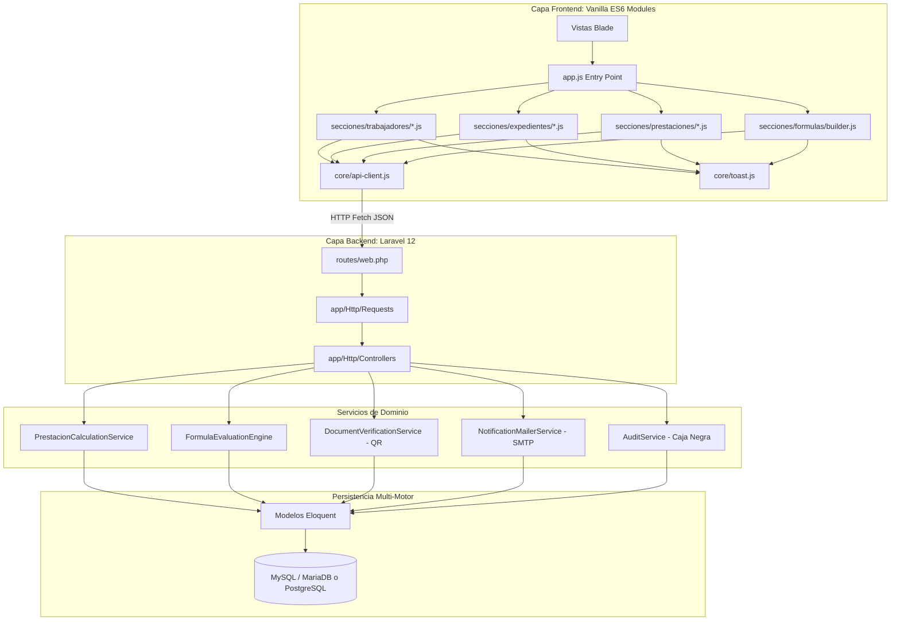

# Documento de Diseño de Software (SDD) — SIGEJUB

**Sistema Integral de Gestión de Jubilaciones**  
**Especificación Técnica de Arquitectura y Diseño Detallado**  
**Fecha:** Octubre 2026 | **Framework:** Laravel 12.x / PHP 8.2+  
**Estrategia Frontend:** Vanilla JavaScript Modular (ES6 Nativo - Cero Dependencias npm)  

---

## 1. Arquitectura de Alto Nivel

SIGEJUB opera bajo una **Arquitectura en Capas Orientada a Servicios de Dominio**, con comunicación desacoplada cliente-servidor mediante endpoints JSON y vistas Blade optimizadas.



---

## 2. Diseño del Backend y Servicios de Dominio

### 2.1. `PrestacionCalculationService` (Cálculo Inmutable en Servidor)
El cálculo de liquidación y prestaciones deja de depender de cualquier dato numérico enviado desde el navegador.

- **Entrada:** `trabajador_id`, `solicitud_id`, opcionalmente `fideicomiso_monto_manual`.
- **Proceso:**
  1. Consulta el sueldo base y las primas activas del trabajador directamente de la base de datos.
  2. Suma los años de servicio institucionales más los antecedentes aprobados (`total_anos_servicio`).
  3. Ejecuta la fórmula activa vía `FormulaEvaluationEngine`.
  4. Extrae la tasa BCV oficial vigente (`TasaCambio::obtenerTasaActual()`).
  5. Genera un hash criptográfico único que sella la liquidación.
- **Salida:** Array estructurado con el desglose exacto, montos en Bolívares y Divisas.

```php
namespace App\Services;

use App\Models\Trabajador;
use App\Models\Prestacion;
use App\Models\FormulaPrestacion;
use App\Models\TasaCambio;

class PrestacionCalculationService
{
    public function __construct(
        protected FormulaEvaluationEngine $formulaEngine
    ) {}

    public function calcular(Trabajador $trabajador): array
    {
        $aniosServicio = (float) $trabajador->total_anos_servicio;
        $sueldoBase = (float) $trabajador->sueldo_base;
        $primasComputables = $this->obtenerTotalPrimas($trabajador);
        $sueldoIntegral = $sueldoBase + $primasComputables;

        $formula = FormulaPrestacion::where('activa', true)->firstOrFail();
        $montoPrestaciones = $this->formulaEngine->evaluar($formula, [
            'sueldo_integral' => $sueldoIntegral,
            'sueldo_base'     => $sueldoBase,
            'anios_servicio'  => $aniosServicio,
            'total_primas'    => $primasComputables,
        ]);

        $tasaActual = TasaCambio::obtenerTasaActual();
        $montoUSD = ($tasaActual && $tasaActual->tasa > 0)
            ? round($montoPrestaciones / $tasaActual->tasa, 2)
            : 0;

        return [
            'trabajador_id'       => $trabajador->id,
            'sueldo_base'         => $sueldoBase,
            'total_primas'        => $primasComputables,
            'sueldo_integral'     => $sueldoIntegral,
            'anios_servicio'      => $aniosServicio,
            'monto_prestaciones'  => round($montoPrestaciones, 2),
            'monto_usd'           => $montoUSD,
            'tasa_bcv'            => (float) ($tasaActual?->tasa ?? 0),
            'formula_id'          => $formula->id,
            'detalles'            => [
                'primas'          => $trabajador->obtenerDesglosePrimas(),
                'tasa_fecha'      => $tasaActual?->created_at?->toIso8601String(),
            ]
        ];
    }
}
```

### 2.2. `DocumentVerificationService` (Código QR y Firma Digital)
- Cada comprobante de pago o carta de aprobación generada en PDF incluirá un código QR vectorial (renderizado vía SVG/PNG en Base64 compatible con DomPDF).
- El QR codifica una URL pública o protegida: `https://dominio-sigejub/verificar/{token_documento}`.
- Al escanear el QR, el sistema muestra una página ligera de validación confirmando:
  - Nombre completo y Cédula del titular.
  - Fecha exacta de emisión y funcionario autorizante.
  - Hash SHA-256 del documento original emitido.

### 2.3. `NotificationMailerService` (Notificaciones SMTP Automatizadas)
- Uso de clases `Mailable` nativas de Laravel (`SolicitudAprobadaMail`, `ExpedienteObservadoMail`).
- Se configuran eventos automáticos disparados en transiciones de estado:
  - Solicitud pasa a `en_revision` o `aprobado`.
  - Expediente alcanza el 100% de recaudos.
  - Prestación calculada y lista para liquidación.

---

## 3. Diseño del Frontend (Vanilla ES6 Modular)

Para garantizar total compatibilidad con **XAMPP**, despliegues rápidos en Windows/Linux y la versión **SIGEJUB-Portable**, el frontend **no utilizará Webpack, Vite ni Node.js**. Se aprovechará el soporte nativo de módulos ES6 (`<script type="module">`).

### Estructura de Directorios Frontend:
```
original/public/js/
├── app.js                          # Punto de entrada principal
├── core/
│   ├── api-client.js              # Fetch unificado, CSRF, errores y sesiones
│   ├── toast.js                   # Notificaciones Toast flotantes y accesibles
│   └── modal-helper.js            # Control unificado de apertura/cierre de modales
└── secciones/
    ├── trabajadores/
    │   ├── index.js               # Orquestador del módulo
    │   ├── listado.js             # Búsqueda, paginación dinámica
    │   ├── formulario.js          # Validaciones cliente y autocompletado
    │   └── antecedentes.js        # Carga documental y tiempos previos
    ├── prestaciones/
    │   ├── index.js
    │   └── simulador.js           # Petición a /prestaciones/simular y render
    └── formulas/
        └── builder.js             # Constructor interactivo de fórmulas
```

### Especificación de `core/api-client.js`:
```javascript
export async function api(url, options = {}) {
    const csrfToken = document.querySelector('meta[name="csrf-token"]')?.content;
    const defaultHeaders = {
        'Accept': 'application/json',
        'X-Requested-With': 'XMLHttpRequest',
        'X-CSRF-TOKEN': csrfToken || ''
    };

    if (!(options.body instanceof FormData)) {
        defaultHeaders['Content-Type'] = 'application/json';
    }

    try {
        const response = await fetch(url, {
            credentials: 'same-origin',
            ...options,
            headers: { ...defaultHeaders, ...options.headers }
        });

        // Sesión expirada o no autenticado
        if (response.status === 401 || response.status === 419) {
            window.location.href = '/login?session_expired=1';
            return null;
        }

        const data = await response.json();
        if (!response.ok) {
            throw { status: response.status, data };
        }
        return data;
    } catch (err) {
        console.error('[API Error]', err);
        throw err;
    }
}
```

---

## 4. Constructor Interactivo de Fórmulas

Para responder al requerimiento de parametrización sin tocar código, se diseñará un módulo en la sección de administración:

1. **Variables Disponibles:**
   - `{sueldo_base}`, `{sueldo_integral}`, `{anios_servicio}`, `{total_primas}`, `{prima_antiguedad}`, `{cesta_ticket}`, `{tasa_bcv}`.
2. **Operadores Soportados:**
   - Aritméticos: `+`, `-`, `*`, `/`, `^`, paréntesis.
   - Condicionales: `IF(anios_servicio >= 25, x, y)`.
3. **Validador de Expresiones en Backend:**
   - Uso de un evaluador matemático seguro (ej. `Symfony\Component\ExpressionLanguage` o parser AST estricto) que impida inyección de código PHP (`eval()` queda estrictamente prohibido).
4. **Prueba en Vivo (*Sandbox*):**
   - El administrador podrá seleccionar un trabajador de muestra y presionar "Probar fórmula" para ver el resultado en tiempo real antes de activarla en el sistema.

---

## 5. Diseño de Seguridad y Auditoría

1. **Inmutabilidad en Caja Negra:**
   - La tabla `activities` incorpora una columna `hash_previo` y `hash_firma`.
   - Se genera una cadena de bloques básica (*hash chain*) que garantiza que ningún registro pueda ser borrado o alterado directamente en phpMyAdmin o consola sin romper la cadena de validación.
2. **Control de Acceso por Roles (RBAC):**
   - `superadmin`: Acceso completo, restauración de respaldos, configuración de fórmulas y auditoría forense.
   - `admin`: Gestión de trabajadores, aprobación de solicitudes, expedientes y cálculo de prestaciones.
   - `operador`: Registro de solicitudes, carga documental y consulta de nóminas.
   - `analista`: Consulta de reportes y auditoría de solo lectura.
