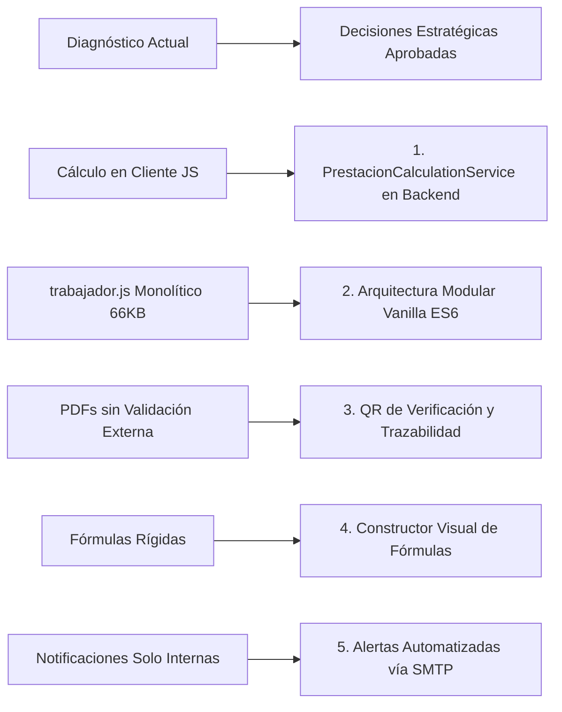

# Propuesta de Evolución y Estandarización SDD — SIGEJUB

**Documento de Especificación y Propuesta Arquitectural (Brownfield SDD)**  
**Proyecto:** Sistema Integral de Gestión de Jubilaciones (SIGEJUB)  
**Fecha:** Octubre 2026 | **Versión Base:** Laravel 12.x / PHP 8.2+ / MySQL & PostgreSQL  
**Estado:** Aprobado y alineado con prioridades de desarrollo  

---

## 1. Resumen Ejecutivo y Justificación

El proyecto **SIGEJUB** es una plataforma integral desarrollada para resolver el ciclo de vida completo de jubilaciones, expedientes de personal, nóminas y prestaciones sociales bajo el marco legal venezolano (LOTTT) en instituciones universitarias o públicas.

Dado su estado de madurez funcional y su capacidad de distribución multiplataforma (Windows con instalador GUI, Linux y versión portable autónoma para XAMPP), la aplicación de la metodología **SDD (Software Design Description / Specification-Driven Development)** en esta etapa persigue cuatro metas estratégicas definidas:

1. **Blindaje Financiero y Legal Server-Side:** Centralizar la lógica y fórmulas de cálculo de prestaciones e intereses exclusivamente en el backend (eliminando el riesgo de manipulación de montos desde el navegador).
2. **Modularización Limpia del Frontend (Vanilla ES6):** Descomponer scripts monolíticos como `trabajador.js` (66 KB) en módulos nativos ES6 sin introducir herramientas pesadas de compilación (cero dependencias de Node.js/npm en producción), preservando la ligereza y portabilidad con XAMPP.
3. **Validación Documental con Código QR y Notificaciones:** Incorporar sellado de autenticidad mediante código QR en comprobantes y cartas de aprobación PDF, junto con notificaciones automáticas por correo electrónico (SMTP).
4. **Constructor Visual de Fórmulas:** Permitir que los administradores configuren dinámicamente nuevas variables y fórmulas de cálculo sin requerir modificaciones en el código fuente.

---

## 2. Diagnóstico del Estado Actual y Decisiones Clave

### Tabla Comparativa: Situación Actual vs. Estado Objetivo

| Componente | Situación Actual | Estado Objetivo (Propuesta Aprobada) |
| :--- | :--- | :--- |
| **Cálculo de Prestaciones** | El cliente JS calcula montos y los envía por POST a `PrestacionesController::store`. | El servidor calcula montos de forma inmutable mediante `PrestacionCalculationService`. El cliente solo solicita simulaciones visuales. |
| **Arquitectura Frontend** | Archivos JS masivos (`trabajador.js` >66KB) con mezcla de DOM, AJAX y modales. | Módulos ES6 nativos organizados por dominios (`core/api-client.js`, `trabajadores/form.js`, etc.) sin requerir Vite ni npm. |
| **Comprobantes y Cartas PDF** | Comprobantes emitidos en DomPDF sin mecanismo de verificación rápida para terceros. | Inclusión de código QR criptográfico único que redirige a verificación pública o interna de autenticidad. |
| **Motor de Fórmulas** | Catálogo `formulas_prestaciones` con lógica predefinida en código. | Constructor interactivo de fórmulas donde el administrador combina variables (sueldo, primas, años) visualmente. |
| **Notificaciones** | Registro en base de datos interna (`user_notifications`) visible solo dentro de la app. | Notificaciones multicanal: bandeja interna + correos electrónicos automáticos (Mailables/SMTP) ante cambios de estatus. |
| **Gestión del Repositorio** | Ramas y carpetas duplicadas (`windows/`, `linux/`, `SIGEJUB-Portable/`). | Una sola fuente de código canónico (`original/`), usando scripts automáticos para generar los paquetes de distribución. |

---

## 3. Plan de Evolución por Fases

### Fase 1: Blindaje del Núcleo y Seguridad Financiera (Inmediato)
- Construcción del servicio de dominio `PrestacionCalculationService`.
- Creación del endpoint `/prestaciones/simular` para previsualizaciones en vivo.
- Implementación de Form Requests para sanitización y validación estricta de entradas.

### Fase 2: Modernización Modular del Frontend (Vanilla ES6)
- Creación de `core/api-client.js` con manejo centralizado de CSRF, errores y sesiones expiradas.
- Fragmentación de `trabajador.js` en submódulos especializados.
- Implementación de componente visual Toast para feedback de usuario sin alertas bloqueantes.

### Fase 3: Trazabilidad, QR y Notificaciones SMTP
- Generación de códigos QR integrados en comprobantes de cálculo y cartas de jubilación emitidas por DomPDF.
- Configuración de cola/envío de correos electrónicos transaccionales cuando una solicitud es aprobada o revisada.

### Fase 4: Constructor Visual de Fórmulas y Pruebas Automatizadas
- Interfaz administrativa interactiva para editar o crear fórmulas de cálculo de prestaciones.
- Suite de pruebas unitarias (PHPUnit) que certifiquen el 100% de los escenarios de liquidación.
